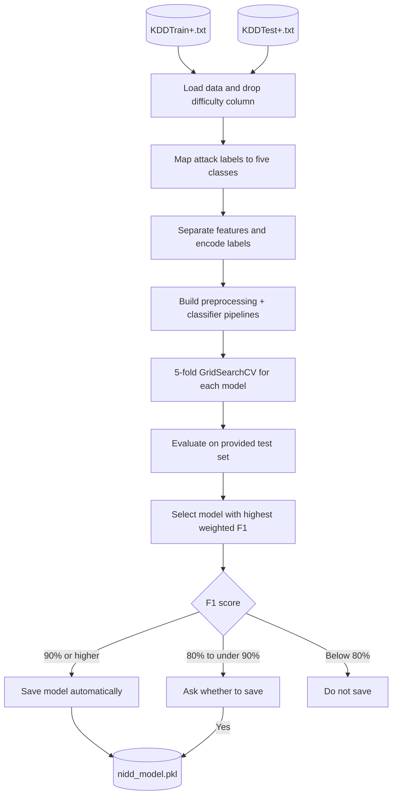

NIDD
A hands-on project where I'm learning to build a machine-learning network intrusion detection system. The focus so far is the training pipeline: loading network traffic data, preparing features, comparing classifiers, tuning hyperparameters, and evaluating how well models recognize different types of attacks.

The working component is backend/train.py, built with pandas and scikit-learn. The repository also contains a React and Vite frontend scaffold. The interface and model are not connected yet.
How it works
Running python train.py from backend/ executes the training pipeline. Data preparation, model selection, and evaluation are handled by functions in the script.

1. Load data: reads the NSL-KDD training and test files in backend/data/ and drops the dataset's difficulty column.
2. Group attack types: maps individual attack names into five classification labels: normal, dos, probe, r2l, and u2r.
3. Prepare features: separates inputs from labels, encodes the target classes, standardizes numerical columns, and one-hot encodes categorical columns.
4. Tune models: runs five-fold cross-validation with GridSearchCV, searching a separate hyperparameter grid for each classifier. Cross-validation uses macro-averaged F1.
5. Evaluate: generates predictions on KDDTest+.txt and prints the weighted F1 score, classification report, and confusion matrix for each model.
6. Select and save: chooses the model with the highest test-set weighted F1 score. Depending on that score, the script saves the trained pipeline and label encoder to nidd_model.pkl automatically, asks for confirmation, or leaves the model unsaved.
Attack categories
Label	Meaning
normal	Network activity labeled as normal
dos	Denial-of-service attacks
probe	Scanning and reconnaissance activity
r2l	Remote-to-local attacks
u2r	User-to-root attacks

Models currently compared
Model	Configuration being explored
Logistic Regression	Regularization strength and l1_ratio
Random Forest	Tree count, depth, feature selection, splitting, leaf size, and bootstrapping
Multi-Layer Perceptron (MLP)	Hidden-layer structure and regularization strength

Each classifier is wrapped in a scikit-learn Pipeline with the same ColumnTransformer preprocessing setup. This keeps preprocessing inside cross-validation rather than fitting it on the entire dataset in advance.
Project layout
NIDD/
├── backend/
│   ├── train.py                # Data loading, preprocessing, tuning, and evaluation
│   └── data/
│       ├── KDDTrain+.txt       # NSL-KDD training data
│       └── KDDTest+.txt        # NSL-KDD test data
│
├── frontend/
│   ├── src/
│   │   ├── App.jsx             # Current Vite/React starter interface
│   │   ├── App.css             # Component styles
│   │   └── index.css           # Global styles
│   ├── package.json           # Frontend dependencies and scripts
│   └── vite.config.js         # Vite configuration
│
├── docs/
│   └── pandas-cheatsheet.md   # Notes on common pandas operations
├── Exercises.ipynb           # Data analysis and ML practice notebook
└── .gitignore
Generated model artifact
When a model meets the save criteria, train.py uses joblib to serialize:
Saved item	Purpose
model	The selected, fitted scikit-learn pipeline, including preprocessing and the classifier
encoder	The fitted LabelEncoder used to translate between numeric predictions and class labels

Both are stored together in nidd_model.pkl. The script writes this file to the current working directory. If you launch training from backend/ as shown below, the file will appear there. The artifact is intended for future prediction and application integration; there is no inference API in the repository yet.
Getting started
Prerequisites
- Python 3 and pip
- Node.js and npm to run the frontend
- Enough time and computing resources for multi-model grid search
The two NSL-KDD text files are already included in backend/data/.
Train the models
From the repository root, create and activate a Python virtual environment (PowerShell):
python -m venv .venv
.\.venv\Scripts\Activate.ps1
pip install pandas scikit-learn joblib
Run the training script:
cd backend
python train.py
The script prints progress for each model's grid search, its evaluation results, and the final model selection. Training may take considerable time because it evaluates many parameter combinations using five-fold cross-validation.
Note: There is currently no pinned Python dependency file. The installation command above covers the libraries used by the training pipeline.

Run the frontend scaffold
In a separate terminal, from the repository root:
cd frontend
npm install
npm run dev
Open the local URL printed by Vite. This currently displays the default React/Vite starter screen. It does not make predictions or communicate with the Python training code.
Learning notes
The repository includes two resources I've used while learning the tools behind the project:
File	Focus
Exercises.ipynb	Practice with pandas, data exploration, grouping, missing values, and basic classification models
docs/pandas-cheatsheet.md	Quick reference for loading, inspecting, filtering, transforming, and aggregating data

Current status and limitations
Version 1 is a training prototype. The code supports model comparison and saving a trained pipeline. The browser interface is still a scaffold, and the repository has no API, live traffic capture, or real-time detection workflow.

The current script also uses the supplied test set to choose the winning model. A more rigorous evaluation would select models using training/validation data and reserve the test set for a final, independent measurement. Reported results will depend on the trained model and execution environment; the repository does not include a reproducible benchmark-results report yet.
Roadmap ideas
- Separate model selection from final test-set evaluation.
- Explore the proposed two-stage detection design: first identify normal versus anomalous traffic with an Isolation Forest, then classify suspicious traffic with a specialist model such as XGBoost.
- Investigate class imbalance and techniques such as ADASYN when training the specialist classifier.
- Add a Python inference API to load the saved model and accept prediction requests.
- Replace the React starter screen with a dashboard for predictions, class breakdowns, and model results.
- Add pinned dependencies, tests, and documented experiments so results are easier to reproduce.
